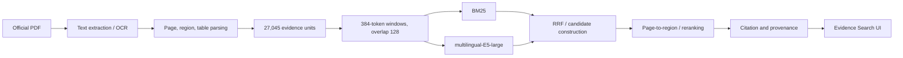

# VietIrr-RAG

> Evidence-first retrieval for long, structured Vietnamese irrigation and water-resource documents.


**VietIrr-RAG** là workspace nghiên cứu truy xuất bằng chứng từ PDF thủy lợi tiếng Việt dài, có bảng biểu, OCR và câu hỏi cần nhiều bằng chứng. Dự án ưu tiên tính kiểm chứng: mỗi kết quả được gắn với tài liệu, trang và evidence ID; không dùng answer hoặc gold annotation trong quá trình inference.

Repository chứa source code, cấu hình thí nghiệm, test, báo cáo đã kiểm chứng và giao diện **Evidence Search**. Raw PDF, embedding cache và model artifact không được đưa lên Git vì dung lượng và trạng thái bản quyền phân phối.

## Trạng thái khoa học

| Hạng mục | Trạng thái |
|---|---|
| Dataset | `V3.2_FINAL_SEMANTIC`, frozen |
| Accepted QA | 545: 378 core + 167 challenge |
| Retrieval DEV | 93 QA, gồm 25 retrieval-multi |
| Document/family leakage | 0 |
| Candidate Test | Sealed; chưa parse/evaluate trong các thí nghiệm |
| Human validation | Chưa hoàn thành (`HUMAN_VALIDATED=false`) |
| Best observed DEV point estimate | All R@20 = 0.6559 |
| Statistical superiority | Chưa được xác nhận |
| Paper ready | Không |

> **Diễn giải đúng:** 0.6559 là point estimate quan sát được ở E4/R2 trên DEV, không phải tuyên bố SOTA. Các khoảng tin cậy theo QA/gold-signature vẫn chạm hoặc chứa 0.

## Bài toán

Cho truy vấn tiếng Việt `q` và tập evidence units `D`, hệ thống trả về Top-K bằng chứng có provenance. Với gold set `Gq`, metric chính là complete-evidence recall:

```text
AllRecall@K = mean_q [ Gq ⊆ TopK(q) ]
```

Khác với single-passage retrieval, một QA có thể cần bằng chứng ở nhiều trang hoặc nhiều tài liệu. Vì vậy dự án tách rõ:

- candidate coverage;
- page localization/pruning;
- region ranking;
- complete-evidence set selection;
- provenance consistency.

## Dataset V3.2

| Thành phần | Số lượng |
|---|---:|
| Tài liệu | 89 |
| Trang | 2.479 |
| Regions | 30.382 |
| Bảng | 406 |
| Evidence units dùng cho retrieval | 27.045 |
| Accepted QA | 545 |
| Source-grounded negatives | 704 |

Phân bố QA: 250 text-only, 131 table-only, 55 text+table và 109 table+table. Có 445 same-page, 34 cross-page cùng tài liệu và 66 cross-document QA.

Raw PDF không được commit. Xem [data/README.md](data/README.md) để biết cấu trúc artifact cần thiết và chính sách dữ liệu.

## Pipeline



### Chunking và embedding

- Evidence unit: text region hoặc table region đủ quality gate.
- Sliding window: 384 content tokens, overlap 128.
- Window aggregation: max pooling về evidence ID gốc.
- Encoder limit: 512 tokens; post-window truncation bằng 0%.
- Dense encoder: `intfloat/multilingual-e5-large`, revision được pin trong config.
- Prefix: `query:` / `passage:`; L2-normalized embedding.
- BM25: `k1=1.5`, `b=0.75`, Unicode NFC/casefold tokenizer.
- Fusion: Reciprocal Rank Fusion với `k=60`.

## Kết quả chính trên DEV

### Baseline B2

| Method | Any R@10 | All R@20 | MRR | nDCG@10 |
|---|---:|---:|---:|---:|
| BM25 | 0.2688 | 0.2796 | 0.0950 | 0.1128 |
| E5 | 0.5161 | 0.5484 | 0.2736 | 0.2937 |
| Hybrid RRF | 0.4839 | 0.4946 | 0.2627 | 0.2767 |
| Page→Region | **0.6452** | **0.5914** | **0.2997** | **0.3412** |

### Các nghiên cứu tiếp theo

| Study | Điều kiện nổi bật | Coverage@100 | All R@20 | Kết luận |
|---|---|---:|---:|---|
| B2.3 | Zero-shot cross-encoder | 0.7742 | 0.6452 | Point gain; CI còn chứa 0 |
| C1.1 | Set-Aware V2 / E4 | 0.7742 | **0.6559** | Multi recall không tăng; chưa support superiority |
| R1 | Table-aware R2, full retrieval | 0.7849 | **0.6559** | Không có reliable contextualization gain |
| MASH-ER | A3 multi-view + soft hierarchy | **0.8602** | 0.4731 | Coverage tăng, rank displacement tăng |
| MAR-ER | M4 adaptive + recovery + stability | 0.8280 | 0.5914 | `STOP_MAR_ER_BRANCH` |

Kết quả nhất quán quan trọng nhất: **candidate coverage tăng không tự động chuyển thành complete-evidence recall**. Candidate mới có thể đẩy gold evidence khỏi Top-20; bottleneck chuyển từ page localization sang region ranking/rank displacement.

## Phase E — Evidence Search

Frontend React/TypeScript cung cấp:

- landing page 3D có WebGL/reduced-motion fallback;
- search workspace với trạng thái backend thật;
- citation, document/page provenance và PDF byte-range;
- document explorer với metadata, filter và indexable regions;
- responsive layout và lazy-loaded Three.js.

Workspace không có LLM serving nên giao diện chủ động ghi **Evidence Search** và không tạo answer giả.

### Chạy local trên Windows

Yêu cầu: Python 3.10+, Node.js 20+ và các artifact mô tả trong [data/README.md](data/README.md).

```powershell
python -m venv .venv
.\.venv\Scripts\python.exe -m pip install -e ".[dev]"
cd frontend
npm.cmd ci
cd ..
.\start_phase_e.cmd
```

Mở `http://127.0.0.1:5173`.

Để chạy pipeline corpus hoặc các thí nghiệm dense/GPU, cài thêm extras tương ứng:

```powershell
.\.venv\Scripts\python.exe -m pip install -e ".[corpus,research]"
```

Chi tiết: [docs/PHASE_E_FRONTEND.md](docs/PHASE_E_FRONTEND.md).

## Cấu trúc repository

```text
configs/       Cấu hình frozen cho B2, C1, R1, MASH-ER, MAR-ER
docs/          Tài liệu frontend và slide báo cáo giữa kỳ
frontend/      React + Vite + TypeScript UI
reports/       Báo cáo/metric chọn lọc; không chứa model cache
scripts/       Build, audit, reproduce và packaging scripts
src/           Retrieval library và read-only Evidence API
tests/         Unit/integration tests
data/README.md Chính sách dữ liệu và layout artifact cục bộ
```

## Kiểm thử

```powershell
.\.venv\Scripts\python.exe -m pytest -q
cd frontend
npm.cmd run typecheck
npm.cmd run build
```

Trạng thái workspace tại lần release này:

- Python: **109 passed**;
- Phase E HTTP/API integration: **4 passed**;
- TypeScript và production build: **PASS**.

## Tái lập và research artifacts

- [B2 baseline](reports/B2/B2_BASELINE_REPORT.md)
- [B2.2 candidate coverage](reports/B2_2/B2_2_REPORT.md)
- [B2.3 reranking](reports/B2_3/B2_3_REPORT.md)
- [C1 evidence selection](reports/C1/C1_REPORT.md)
- [R1 representation](reports/R1/R1_REPORT.md)
- [MASH-ER](reports/MASH_ER/MASH_ER_REPORT.md)
- [MAR-ER one-shot](reports/MAR_ER_EXPERIMENT/MAR_ER_REPORT.md)
- [Báo cáo trình chiếu](docs/VIETIRR_RAG_MIDTERM_PRESENTATION.md)

Các thí nghiệm giữ Candidate Test sealed và lưu checksum/config để audit. Model weights, `.npy`, `.pkl`, raw PDFs và generated rankings lớn được tái tạo hoặc phân phối ngoài Git.

## Hạn chế

- Dataset chưa được human validated.
- 25 multi-evidence DEV QA chỉ tương ứng 8 unique multi gold sets.
- Dev đã được sử dụng nhiều lần cho diagnosis; kết quả là exploratory.
- Candidate Test chưa được đánh giá và có family concentration cao.
- OCR/table extraction và metadata thời gian còn hạn chế.
- Chưa có external benchmark, user study hoặc answer-generation evaluation.

## Data, license và citation

Source PDFs đến từ các nguồn chính thống nhưng `redistribution_status` có thể là `UNCLEAR`; repository không tái phân phối các PDF đó. Người dùng phải tuân thủ điều khoản của từng nguồn gốc.

Repository hiện **không tuyên bố một giấy phép mặc định** cho code hoặc annotations. Vui lòng liên hệ chủ repository trước khi tái sử dụng hoặc phân phối lại.

Khi trích dẫn, vui lòng dùng tên dự án và URL:

```bibtex
@software{vietirr_rag_2026,
  title  = {VietIrr-RAG: Evidence-first Retrieval for Vietnamese Irrigation Documents},
  year   = {2026},
  url    = {https://github.com/zudoan/VietIrr-RAG}
}
```

## Scientific integrity

Không claim SOTA, không claim paper-ready và không xem point estimate trên Dev là bằng chứng superiority. Negative results của MASH-ER/MAR-ER được giữ nguyên để bảo toàn tính tái lập và giá trị chẩn đoán.
