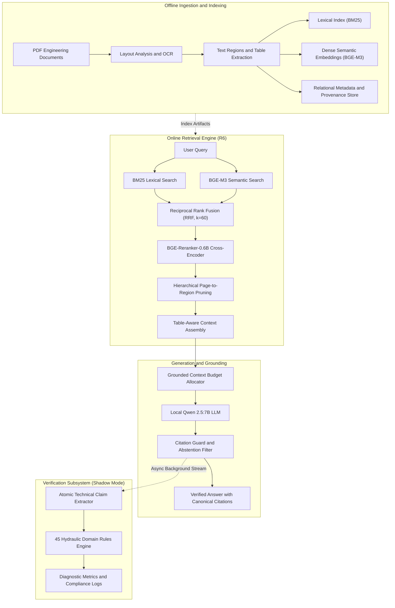

# VietIrr-RAG

### Evidence-Grounded Question Answering over Vietnamese Irrigation Documents

VietIrr-RAG is a research software system for evidence-grounded retrieval-augmented generation (RAG) over Vietnamese hydraulic engineering, dam safety, and water resource documentation. The platform couples hierarchical sparse-dense retrieval (BM25 + BGE-M3 + RRF + Cross-Encoder reranking), layout-aware Page-to-Region evidence localization, local generative language modeling (Qwen 2.5:7B), strict citation guarding, and asynchronous domain ontology verification.

[Tiếng Việt](docs/README.vi.md) | [Architecture Specification](docs/ARCHITECTURE.md) | [Retrieval Pipeline](docs/RETRIEVAL_PIPELINE.md) | [Evaluation Protocol](docs/EVALUATION.md) | [Ontology Verification](docs/ONTOLOGY_VERIFICATION.md) | [Setup Guide](docs/SETUP.md) | [Data Governance](docs/DATA_AVAILABILITY.md)

---

## Table of Contents

- [Project Overview](#project-overview)
- [System Architecture](#system-architecture)
- [Key Technical Components](#key-technical-components)
- [Corpus and Benchmarks](#corpus-and-benchmarks)
- [Retrieval Evaluation](#retrieval-evaluation)
- [Ontology-Constrained Verification](#ontology-constrained-verification)
- [Web Application and Evidence Workspace](#web-application-and-evidence-workspace)
- [Quick Start](#quick-start)
- [Repository Structure](#repository-structure)
- [Testing and Reproducibility](#testing-and-reproducibility)
- [Research History](#research-history)
- [Known Limitations](#known-limitations)
- [Data Availability and Governance](#data-availability-and-governance)
- [Citation](#citation)

---

## Project Overview

### The Engineering Challenge
Hydraulic infrastructure reports, dam safety assessments, and reservoir operation procedures in Vietnam present distinctive obstacles for standard retrieval-augmented generation:
- **Long-Form Multi-Page Structure**: Engineering dossiers span dozens or hundreds of pages comprising legal mandates, technical drawings, cross-sectional profiles, and hydrological records.
- **Dense Quantitative Telemetry**: Critical engineering decisions depend on fine-grained numerical parameters—such as dead water elevation (Mực nước chết - MNC), normal water elevation (Mực nước dâng bình thường - MNDBT), design flood elevation (Mực nước lũ kiểm tra - MNLKT), spillway discharge capacity, and active reservoir storage.
- **Complex Tabular Data**: Crucial operating rules reside within multi-column, multi-page matrices detailing elevation-capacity relationships, stage-discharge curves, and gate opening schedules. Flattening these tables into unstructured text strips necessary coordinate relations.
- **Mandatory Provenance**: In civil engineering decision-making, ungrounded generative assertions present severe operational risks. Every generated claim must be bound to verifiable, immutable source coordinates (document ID, page number, and bounding box region).

### The VietIrr-RAG Approach
VietIrr-RAG addresses these challenges through a principled, evidence-first design:
1. **Hierarchical Page-to-Region Localization**: Rather than treating documents as flat bags of chunks, the retrieval engine first identifies document candidates, prunes non-relevant pages, and then extracts targeted text blocks and table cells.
2. **Table-Aware Context Construction**: Structured table parsers preserve row-column bindings and numerical precision.
3. **Local Generative Grounding**: A locally deployed LLM (Qwen 2.5:7B) generates concise factual answers restricted strictly to provided evidence blocks.
4. **Citation Guard**: A post-generation verification filter validates that every statement is supported by a valid canonical evidence identifier (`REG_...` or `TAB_...`), triggering controlled abstention if evidence is absent.
5. **Ontology Monitoring in Shadow Mode**: An asynchronous domain verification module extracts structured technical claims and checks them against 45 formal hydraulic rules to log compliance telemetry without obstructing real-time response latency.

---

## System Architecture

The following diagram illustrates the decoupled pipeline separating offline document ingestion from online hybrid retrieval, answer generation, and background ontology verification.



---

## Key Technical Components

### 1. Document Understanding and Indexing
PDF dossiers are processed into structured units preserving document geometry. Text blocks are indexed alongside bounding-box coordinates, while tabular regions retain cell matrices, column headers, and elevation keys.

### 2. Hybrid Sparse-Dense Retrieval
- **Lexical Search (BM25)**: Tuned for Vietnamese hydraulic terminology, reservoir nomenclature, and legal decree identifiers (e.g., `Quyết định 1201/QĐ-TTg`).
- **Dense Semantic Search (BGE-M3)**: Encodes text and table descriptions into 1024-dimensional normalized vectors to capture semantic intent and query paraphrases.

### 3. Reciprocal Rank Fusion and Cross-Encoder Reranking
Candidates from BM25 and BGE-M3 are merged via Reciprocal Rank Fusion ($k=60$). The top 50 candidates are scored using `BAAI/bge-reranker-large` / `bge-reranker-v2-m3` to model deep token interactions between questions and document context.

### 4. Hierarchical Page-to-Region Localization
Rather than returning arbitrary passages, the R6 retriever executes two-stage localization:
1. **Document and Page Pruning**: Identifies the primary document sources and isolates high-density evidence pages.
2. **Region Isolation**: Extracts exact bounding boxes (`TEXT_REGION` or `TABLE_REGION`), preventing extraneous text from diluting context attention.

### 5. Table-Aware Evidence Assembly
Tabular evidence units are serialized preserving structural headers, row identifiers, and numerical units, allowing the generative model to resolve multi-column lookups (e.g., matching a given reservoir water level to its corresponding spillway discharge volume).

### 6. Local LLM Answer Generation
Local inference via `Qwen2.5:7B` (executed via Ollama or vLLM) guarantees data privacy and predictable operational costs. Generation prompts enforce factual grounding and prohibit speculative extrapolation.

### 7. Citation Guard and Controlled Abstention
The citation guard inspects the output of the model:
- Asserts that every key claim references a canonical evidence token (`[REG_...]` or `[TAB_...]`).
- Validates that cited IDs correspond to evidence blocks actually present in the prompt context.
- Triggers controlled abstention (`"Không có đủ căn cứ trong tài liệu..."`) when supporting evidence is insufficient or unverified.

### 8. Ontology-Constrained Verification (Shadow Mode)
An asynchronous verification pipeline checks generated assertions against 45 formal civil engineering constraints. The system operates in non-blocking Shadow Mode to provide observational telemetry without introducing false rejections during live inference.

---

## Corpus and Benchmarks

### Corpus Specifications

| Metric / Attribute | Active Operational Corpus (`V4_R6_FROZEN`) | Historical Baseline (`V3.2_FINAL_SEMANTIC`) |
| :--- | :---: | :---: |
| **Document Count** | **93** verified dossiers | 89 dossiers |
| **Total Pages** | **2,578** pages | 2,479 pages |
| **Total Evidence Units** | **27,144** units | 27,045 units |
| **Text Regions** | 27,053 regions | 26,639 regions |
| **Structured Table Regions** | 91 table matrices | 406 unflattened fragments |
| **Language** | Vietnamese (`vi`) | Vietnamese (`vi`) |
| **Domain** | Hydraulic engineering, dam safety, hydrology | Hydraulic engineering, hydrology |
| **Primary Manifest** | `data/v4_corpus/metadata/v4_corpus_manifest.jsonl` | `data/corpus/metadata/v3_2_manifest.jsonl` |

The complete research dataset and evaluation resources are hosted in a dedicated public repository:
- **Dataset Repository**: [https://github.com/zudoan/vietirr-rag-dataset](https://github.com/zudoan/vietirr-rag-dataset)

### Evaluation Benchmark Splits

- **DEV-93** (`data/benchmark/dev.jsonl`): 93 frozen questions evaluating complex multi-hop retrieval and table lookups across multi-page engineering reports.
- **ALL-QA-545** (`data/benchmark/all_qa.jsonl`): 545 verified question-evidence pairs spanning the broader curriculum of Vietnamese hydraulic engineering.

---

## Retrieval Evaluation

The table below presents the verified retrieval and localization performance on the frozen **DEV-93** benchmark. Metrics are reproduced directly from the frozen artifact `reports/EXPERIMENTS/R6_RETRIEVAL_DEV93_METRICS.json`.

| Evaluation Metric | Baseline R5 | Active Pipeline R6 | Absolute Delta |
| :--- | :---: | :---: | :---: |
| **Candidate Hit@100** | 76.34% (71/93) | **91.40% (85/93)** | +15.06% |
| **Page Hit@5** | 63.44% (59/93) | **67.74% (63/93)** | +4.30% |
| **Evidence Page Hit@5** | 58.06% (54/93) | **61.29% (57/93)** | +3.23% |
| **MRR@5** | 0.4579 | **0.4511** | -0.0068 |
| **nDCG@5** | 0.4894 | **0.5077** | +0.0183 |
| **Table Region Recovery** | 0.00% (0/93) | **17.20% (16/93)** | +17.20% |
| **Median Latency (p50)** | 4,505 ms | **4,401 ms** | -104 ms |
| **95th Percentile Latency (p95)** | 5,963 ms | **5,564 ms** | -399 ms |

### Paired Comparison on Page Hit@5:
- **R6 Wins**: 10 questions
- **R6 Losses**: 6 questions
- **Ties**: 77 questions

> **Scientific Metric Distinction:**
> Hit@K and MRR@K quantify the retrieval system's capability to localize evidence-bearing pages within candidate pools. They do **not** represent end-to-end factual answer accuracy. End-to-end answer correctness has not yet been established by a comprehensive independent evaluation.

For complete evaluation protocols, see [docs/EVALUATION.md](docs/EVALUATION.md).

---

## Ontology-Constrained Verification

In safety-critical hydraulic systems, factual discrepancies regarding dam heights, spillway capacities, or reservoir volumes carry serious engineering implications. The ontology subsystem formalizes domain knowledge to audit generated statements:

### 1. Atomic Claim Representation
Generated texts are parsed into structured claims:
```text
TechnicalClaim {
    entity:           "Hồ Thác La",
    parameter:        "diện tích đáp ứng",
    value:            342.0,
    unit:             "ha",
    temporal_context: "tháng 06/2019",
    evidence_id:      "TAB_IRR_CTL_2019_1fc21515_P0003_02_R002_C003"
}
```

### 2. Formal Domain Constraints
The system incorporates 45 hydraulic domain rules (`ontology/constraints_v0_1.ttl`), including:
- **Water Elevation Hierarchy**: $MNC \le MNDBT \le MNLKT \le CaoTrinhDinhDam$
- **Physical Feasibility Bounds**: Discharge thresholds, reservoir capacity ceilings, and unit consistency.

### 3. Shadow Mode Architecture
Controlled ablation experiments (A0 through A3) demonstrated that hard blocking on automated claim verification introduced an 8.3% false rejection rate due to natural language variability. As a result, the operational system implements ontology verification in **Shadow Mode**: verification executes asynchronously, emitting diagnostic signals and metrics without disrupting end-user interaction.

For full technical specifications, see [docs/ONTOLOGY_VERIFICATION.md](docs/ONTOLOGY_VERIFICATION.md).

---

## Web Application and Evidence Workspace

The repository includes a modern, high-density web application built with React, TypeScript, and Tailwind/Vanilla CSS, backed by a FastAPI service.

### Search and Retrieval Workspace
The primary workspace provides multi-modal query execution, candidate filtering, and granular evidence inspectability.


*Figure 1: VietIrr-RAG search interface displaying query input, stage telemetry, and multi-candidate retrieval ranking.*

### Grounded Answer Generation with Citation Cards
Answers generated by the local Qwen model include explicit citation anchors mapped to extracted evidence cards.


*Figure 2: Factual answer generation with interactive citation chips linking directly to localized document provenance.*

### Inline Document Evidence Viewer
Users can inspect original PDF documents with bounding box overlays highlighting the precise location of retrieved evidence.


*Figure 3: Built-in PDF.js evidence viewer rendering original document pages with highlighted evidence regions.*

---

## Quick Start

### System Requirements
- Python 3.10 or 3.11
- Node.js 20.x or higher
- Ollama with `qwen2.5:7b` model loaded
- 16 GB RAM minimum (32 GB recommended)

### 1. Model Serving Setup
Ensure Ollama is running and pull the model:
```bash
ollama run qwen2.5:7b
```

### 2. Backend Service Setup
```bash
# Clone the repository
git clone https://github.com/zudoan/VietIrr-RAG.git
cd VietIrr-RAG

# Create and activate virtual environment
python -m venv .venv
# On Windows PowerShell:
.venv\Scripts\Activate.ps1
# On Linux / macOS:
source .venv/bin/activate

# Install dependencies in editable mode
pip install -e .

# Launch FastAPI backend
uvicorn viirr_api.app:app --host 127.0.0.1 --port 8000 --reload
```

The API service will start on `http://127.0.0.1:8000`. API documentation is available at `http://127.0.0.1:8000/docs`.

### 3. Frontend Web Application Setup
In a new terminal window:
```bash
cd frontend
npm install
npm run dev
```

Open `http://127.0.0.1:5173` in your browser to access the evidence workspace.

For complete deployment options, production settings, and environment variables, refer to [docs/SETUP.md](docs/SETUP.md).

---

## Repository Structure

```text
VietIrr-RAG/
├── configs/                  # Pipeline, retrieval, and model configuration files
├── data/
│   ├── benchmark/            # Frozen evaluation sets (DEV-93, ALL-QA-545)
│   └── v4_corpus/            # V4 corpus metadata, manifests, and index artifacts
├── docs/                     # Comprehensive technical documentation
│   ├── assets/screenshots/   # System interface figures and screenshots
│   ├── ARCHITECTURE.md       # Full tier and dataflow architecture specification
│   ├── DATA_AVAILABILITY.md  # Data governance, redistribution, and repository links
│   ├── EVALUATION.md         # Benchmark definitions and experimental evaluation protocol
│   ├── ONTOLOGY_VERIFICATION.md # Ontology claim schema, constraints, and Shadow Mode
│   ├── README.vi.md          # Scientific Vietnamese translation
│   ├── RESEARCH_HISTORY.md   # Historical evolution from V3.2 / B2 to R6
│   ├── RETRIEVAL_PIPELINE.md # Detailed specification of R6 hybrid retrieval stages
│   └── SETUP.md              # Local installation and deployment guide
├── frontend/                 # React / Vite TypeScript web application
│   ├── src/components/       # Evidence cards, PDF viewer, shell components
│   └── src/pages/            # Workspace, documents, and presentation views
├── ontology/                 # OWL/TTL formal schemas and 45 hydraulic domain rules
├── reports/EXPERIMENTS/      # Frozen experimental metrics, baseline traces, and evaluations
├── scripts/                  # Benchmarking, diagnostic, and evaluation CLI scripts
├── src/
│   ├── viirr_api/            # FastAPI REST backend, database models, schemas, and routes
│   ├── viirr_ontology/       # Atomic claim extraction and shadow verification engine
│   ├── viirr_rag/            # Prompt construction, context allocator, and Citation Guard
│   └── viirr_retrieval/      # BM25, BGE-M3, RRF fusion, reranker, and Page-to-Region
└── tests/                    # Comprehensive test suite (585 regression and unit tests)
```

For an exhaustive audit of workspace files, consult [PROJECT_STRUCTURE.md](PROJECT_STRUCTURE.md).

---

## Testing and Reproducibility

VietIrr-RAG enforces comprehensive unit, integration, and security test coverage:

```bash
# Execute backend test suite (585 tests)
pytest tests/ -q

# Execute frontend build verification
cd frontend
npm run build
```

Test coverage includes:
- **Retrieval Contract**: Verifies absence of test set leakage and checks candidate provenance integrity.
- **Citation Guard**: Validates citation parsing, ID binding, and controlled abstention paths.
- **Ontology Verification**: Tests claim extraction tuples against hydraulic constraint invariants.
- **API Endpoints**: Validates request rate limiting, payload sanitization, and health check routes.

---

## Research History

The system reflects progressive experimental iterations:
- **Baseline V3.2 / Milestone B2**: Semantic search prototype over 89 PDFs using `multilingual-e5-large`; evaluated flat evidence search without LLM answer generation.
- **Milestone C1 / R1**: Sparse-dense comparison identifying BM25 advantages for technical vocabulary and legal identifiers.
- **Milestone R5**: First integration of Reciprocal Rank Fusion with BGE-M3 and cross-encoder reranking.
- **Milestone R6 (Active Baseline)**: Introduction of hierarchical Page-to-Region localization and structured table extraction, achieving 91.40% Candidate Hit@100 on DEV-93.
- **Phase E & Full-Stack Deployment**: Implementation of local Qwen 2.5:7B generation, Citation Guard enforcement, interactive PDF evidence viewing, and asynchronous Ontology Shadow Mode.

For detailed milestone progression, see [docs/RESEARCH_HISTORY.md](docs/RESEARCH_HISTORY.md).

---

## Known Limitations

- **Complex Engineering Drawings**: Scanned blueprints, dam cross-section diagrams, and handwritten operational logs cannot be reliably interpreted by standard OCR engines.
- **Multi-Page Table Stitching**: Tables split across page boundaries without repeating headers occasionally suffer from column misalignments during parsing.
- **Generative Abstention Sensitivity**: The Citation Guard enforces strict evidence binding; occasionally, answers that paraphrase valid facts without explicitly appending canonical IDs are conservatively rejected.
- **Ontology Extraction Coverage**: Highly nuanced natural language assertions can fail automatic tuple extraction, which motivated the use of non-blocking Shadow Mode over hard rejection.
- **Evaluation Scope**: Retrieval metrics (Hit@K, MRR@K) evaluate evidence localization. End-to-end factual correctness requires further independent manual annotation.

---

## Data Availability and Governance

The primary dataset is maintained in a dedicated public repository:
- [https://github.com/zudoan/vietirr-rag-dataset](https://github.com/zudoan/vietirr-rag-dataset)

Raw engineering documents are subject to organizational distribution policies. Derived structured representations (bounding boxes, layout coordinates, anonymous text tokens, and metadata manifests) are made available for research reproducibility.

For data governance terms, see [docs/DATA_AVAILABILITY.md](docs/DATA_AVAILABILITY.md).

---

## Citation

If you utilize VietIrr-RAG or its associated benchmark datasets in your research, please cite the project as follows:

```bibtex
@software{vietirr_rag_2026,
  author       = {Doan, Tu and contributors},
  title        = {VietIrr-RAG: Evidence-Grounded Question Answering over Vietnamese Irrigation Documents},
  year         = {2026},
  publisher    = {GitHub},
  journal      = {GitHub repository},
  howpublished = {\url{https://github.com/zudoan/VietIrr-RAG}}
}
```

---

## Acknowledgements

VietIrr-RAG was developed as part of advanced deep learning and information retrieval research in the Department of Water Resources and Civil Engineering. We express our appreciation to the open-source community for providing foundational models including BAAI BGE-M3 and the Qwen series.
