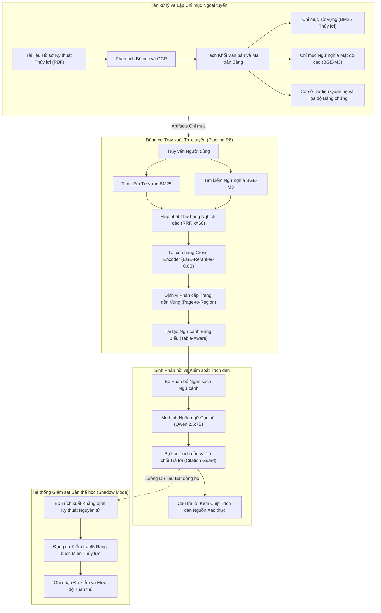
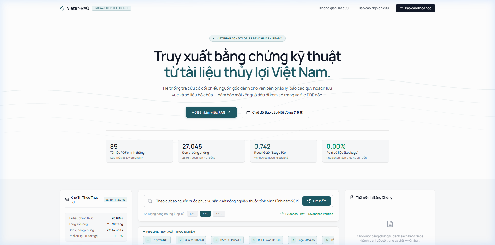
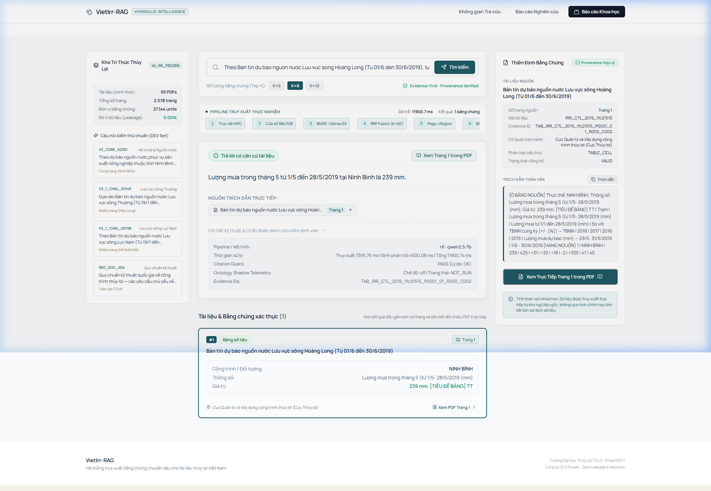
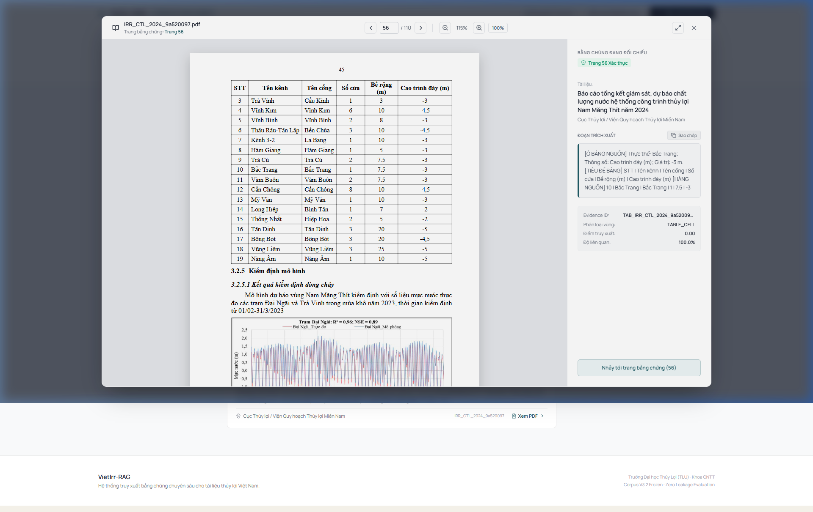

# VietIrr-RAG

### Hệ thống Hỏi đáp và Truy xuất Định vị Bằng chứng cho Tài liệu Thủy lợi Tiếng Việt

VietIrr-RAG là hệ thống phần mềm nghiên cứu phục vụ hỏi đáp có căn cứ (Retrieval-Augmented Generation - RAG) chuyên biệt cho hồ sơ kỹ thuật công trình thủy lợi, quy trình vận hành hồ chứa và an toàn đập tại Việt Nam. Nền tảng kết hợp truy xuất hỗn hợp phân cấp (BM25 + BGE-M3 + RRF + Cross-Encoder reranking), định vị bằng chứng theo cấu trúc bố cục từ Trang đến Vùng (Hierarchical Page-to-Region), mô hình ngôn ngữ sinh cục bộ (Qwen 2.5:7B), cơ chế kiểm soát trích dẫn nghiêm ngặt (Citation Guard) và giám sát bản thể học miền thủy lực ở chế độ chạy ngầm (Ontology Shadow Mode).

[English Version](docs/README.en.md) | [Đặc tả Kiến trúc](docs/ARCHITECTURE.md) | [Quy trình Truy xuất R6](docs/RETRIEVAL_PIPELINE.md) | [Nghi thức Đánh giá](docs/EVALUATION.md) | [Giám sát Bản thể học](docs/ONTOLOGY_VERIFICATION.md) | [Hướng dẫn Khởi chạy](docs/SETUP.md) | [Quản trị Dữ liệu](docs/DATA_AVAILABILITY.md)

---

## Mục lục

- [Tổng quan Dự án và Thách thức Kỹ thuật](#tổng-quan-dự-án-và-thách-thức-kỹ-thuật)
- [Kiến trúc Hệ thống](#kiến-trúc-hệ-thống)
- [Các Thành phần Kỹ thuật Cốt lõi](#các-thành-phần-kỹ-thuật-cốt-lõi)
- [Tập Dữ liệu và Tiêu chuẩn Đánh giá](#tập-dữ-liệu-và-tiêu-chuẩn-đánh-giá)
- [Kết quả Đánh giá Thực nghiệm](#kết-quả-đánh-giá-thực-nghiệm)
- [Xác thực Ràng buộc Bản thể học](#xác-thực-ràng-buộc-bản-thể-học)
- [Ứng dụng Web và Không gian Làm việc Bằng chứng](#ứng-dụng-web-và-không-gian-làm-việc-bằng-chứng)
- [Hướng dẫn Khởi chạy Nhanh](#hướng-dẫn-khởi-chạy-nhanh)
- [Cấu trúc Kho Lưu trữ](#cấu-trúc-kho-lưu-trữ)
- [Kiểm thử và Tính Tái lập](#kiểm-thử-và-tính-tái-lập)
- [Tiến trình Lịch sử Nghiên cứu](#tiến-trình-lịch-sử-nghiên-cứu)
- [Hạn chế Khoa học Đã Biết](#hạn-chế-khoa-học-đã-biết)
- [Chính sách Dữ liệu và Bản quyền](#chính-sách-dữ-liệu-và-bản-quyền)
- [Trích dẫn Khoa học](#trích-dẫn-khoa-học)

---

## Tổng quan Dự án và Thách thức Kỹ thuật

### Thách thức Kỹ thuật trong Thủy lợi
Hồ sơ kỹ thuật công trình thủy lợi, báo cáo kiểm định an toàn đập và quy trình vận hành liên hồ chứa tại Việt Nam mang các đặc trưng phức tạp gây cản trở lớn đối với các kiến trúc RAG thông thường:
- **Cấu trúc Tài liệu Dài và Đa trang**: Các hồ sơ kỹ thuật thường kéo dài từ hàng chục đến hàng trăm trang, tích hợp văn bản pháp quy, thuyết minh tính toán, bản vẽ thiết kế và phụ lục số liệu thủy văn.
- **Dữ liệu Số liệu Thủy lực Mật độ Cao**: Quyết định điều hành đòi hỏi sự chuẩn xác tuyệt đối trên các tham số định lượng quan trọng—như cao trình mực nước chết (MNC), mực nước dâng bình thường (MNDBT), mực nước lũ kiểm tra (MNLKT), lưu lượng xả tràn thiết kế, dung tích hữu ích và diện tích tưới phụ trách.
- **Bảng Biểu Kỹ thuật Phức tạp**: Rất nhiều quy tắc vận hành và tương quan cao trình - dung tích - diện tích ngập nằm trong các bảng ma trận nhiều cột, nhiều tầng tiêu đề hoặc kéo dài qua nhiều trang. Việc làm phẳng (flatten) bảng biểu thành văn bản thuần làm phá vỡ tọa độ hàng - cột và mất quan hệ ngữ cảnh số liệu.
- **Yêu cầu Bắt buộc về Căn cứ Pháp lý và Tọa độ Bằng chứng**: Trong công trình thủy lợi, một câu trả lời suy diễn sai lệch hoặc không có căn cứ có thể dẫn đến rủi ro nghiêm trọng về an toàn đập. Mọi khẳng định đưa ra bắt buộc phải được gắn chặt với tọa độ gốc xác thực (mã tài liệu, số trang và vùng tọa độ bounding box).

### Giải pháp Kỹ thuật của VietIrr-RAG
VietIrr-RAG giải quyết các thách thức trên thông qua thiết kế lấy bằng chứng làm trung tâm (Evidence-First):
1. **Định vị Bằng chứng Phân cấp (Hierarchical Page-to-Region)**: Thay vì chia cắt tài liệu thành các đoạn rời rạc (chunks), bộ truy xuất định vị theo hai bước: chọn lọc tài liệu ứng viên, lọc các trang có mật độ bằng chứng cao nhất, sau đó cô lập chính xác từng khối văn bản hoặc ô bảng dữ liệu.
2. **Tái tạo Ngữ cảnh Nhận biết Cấu trúc Bảng (Table-Aware)**: Bộ bóc tách bảo toàn ma trận hàng - cột, tiêu đề cột và đơn vị đo, cho phép mô hình ngôn ngữ tra cứu chính xác số liệu đối chiếu.
3. **Sinh Câu trả lời Cục bộ Ràng buộc Bằng chứng**: Sử dụng mô hình ngôn ngữ lớn chạy cục bộ (Qwen 2.5:7B) với prompt ép buộc chỉ sử dụng dữ kiện có trong ngữ cảnh được cung cấp.
4. **Bộ Lọc Trích dẫn (Citation Guard)**: Kiểm tra hậu xử lý câu trả lời sinh ra, đối soát mọi khẳng định với mã định danh bằng chứng hợp lệ (`REG_...` hoặc `TAB_...`), tự động từ chối trả lời nếu ngữ cảnh không đủ căn cứ.
5. **Giám sát Bản thể học Chạy ngầm (Ontology Shadow Mode)**: Module kiểm tra độc lập trích xuất các khẳng định kỹ thuật nguyên tử và đối soát với 45 ràng buộc thủy lực chính thức để ghi nhận dữ liệu đo kiểm mà không gây trễ hoặc chặn phản hồi của người dùng.

---

## Kiến trúc Hệ thống

Sơ đồ dưới đây thể hiện quy trình xử lý tách bạch giữa giai đoạn nạp và lập chỉ mục ngoại tuyến với luồng truy xuất, sinh câu trả lời và giám sát bản thể học trực tuyến.



---

## Các Thành phần Kỹ thuật Cốt lõi

### 1. Hiểu Tài liệu và Lập Chỉ mục Bố cục
Các hồ sơ PDF kỹ thuật được phân tách thành các đơn vị bằng chứng giữ nguyên hình học không gian. Khối văn bản được gắn tọa độ bounding box trên từng trang, trong khi các bảng biểu giữ nguyên cấu trúc ma trận, tiêu đề cột và các khóa cao trình.

### 2. Truy xuất Hỗn hợp Từ vựng - Ngữ nghĩa
- **Truy xuất Từ vựng (BM25)**: Tối ưu hóa bộ tách từ cho thuật ngữ kỹ thuật thủy lợi Việt Nam, tên hồ đập đặc thù và số hiệu văn bản quy phạm (ví dụ: `Quyết định 1201/QĐ-TTg`).
- **Truy xuất Ngữ nghĩa (BGE-M3)**: Mã hóa văn bản và mô tả bảng thành vector chuẩn hóa 1024 chiều, xử lý các câu hỏi mang tính khái niệm hoặc diễn giải ngữ nghĩa.

### 3. Hợp nhất RRF và Tái xếp hạng Cross-Encoder
Danh sách ứng viên từ BM25 và BGE-M3 được kết hợp thông qua thuật toán Reciprocal Rank Fusion ($k=60$). Top 50 ứng viên được đưa qua mô hình `BAAI/bge-reranker-large` / `bge-reranker-v2-m3` để tính toán tương quan chú ý sâu (cross-attention) giữa câu hỏi và văn bản ứng viên.

### 4. Định vị Phân cấp Trang đến Vùng (Hierarchical Page-to-Region)
Khác với cách tiếp cận chia đoạn phẳng, động cơ R6 áp dụng quy trình lọc hai cấp:
1. **Lọc Tài liệu và Trang**: Xác định tài liệu nguồn chính và định vị các trang có mật độ thông tin tập trung nhất.
2. **Cô lập Vùng**: Trích xuất chính xác bounding box (`TEXT_REGION` hoặc `TABLE_REGION`), loại bỏ các nội dung ngoại lai không liên quan gây nhiễu ngữ cảnh.

### 5. Tái tạo Bằng chứng Bảng biểu (Table-Aware Context)
Các vùng bảng kỹ thuật được chuẩn hóa cấu trúc thành chuỗi dữ liệu có cấu trúc bao gồm tiêu đề, tên cột và đơn vị đo, cho phép mô hình ngôn ngữ tra cứu số liệu đa chiều (ví dụ: đối chiếu cao trình mực nước hồ với lưu lượng xả đáy tương ứng).

### 6. Mô hình Ngôn ngữ Sinh Cục bộ
VietIrr-RAG sử dụng mô hình `Qwen2.5:7B` chạy trên hạ tầng cục bộ (thông qua Ollama hoặc vLLM), đảm bảo tính bảo mật của dữ liệu kỹ thuật và chi phí vận hành độc lập. Prompt sinh câu trả lời áp đặt kỷ luật dữ kiện nghiêm ngặt, ngăn chặn suy diễn vô căn cứ.

### 7. Bộ Lọc Trích dẫn (Citation Guard) và Từ chối Trả lời
Sau khi mô hình sinh câu trả lời, bộ lọc Citation Guard thực hiện:
- Bắt buộc mọi luận điểm phải kèm mã định danh bằng chứng hợp lệ (`[REG_...]` hoặc `[TAB_...]`).
- Kiểm tra tính hợp lệ của mã trích dẫn đối với các khối ngữ cảnh thực sự được cung cấp cho LLM.
- Kích hoạt cơ chế từ chối trả lời an toàn (`"Không có đủ căn cứ trong tài liệu..."`) khi bằng chứng không đủ độ tin cậy.

### 8. Giám sát Ràng buộc Bản thể học (Shadow Mode)
Quy trình xác thực bất đồng bộ trích xuất các bộ khẳng định nguyên tử và đối soát với 45 ràng buộc thủy lực. Module chạy ở chế độ Shadow Mode (không can thiệp luồng phản hồi trực tiếp) để cung cấp dữ liệu đo kiểm và cảnh báo vi phạm số liệu.

---

## Tập Dữ liệu và Tiêu chuẩn Đánh giá

### Thống kê Tập Dữ liệu Hoạt động

| Chỉ số / Thuộc tính | Tập Hoạt động Hiện tại (`V4_R6_FROZEN`) | Tập Baseline Lịch sử (`V3.2_FINAL_SEMANTIC`) |
| :--- | :---: | :---: |
| **Số lượng Tài liệu** | **93** hồ sơ kỹ thuật | 89 hồ sơ |
| **Tổng số Trang** | **2.578** trang | 2.479 trang |
| **Tổng số Đơn vị Bằng chứng** | **27.144** đơn vị | 27.045 đơn vị |
| **Vùng Văn bản (Text Regions)** | 27.053 vùng | 26.639 vùng |
| **Vùng Bảng biểu Cấu trúc** | 91 ma trận bảng | 406 mảnh cắt thô |
| **Ngôn ngữ** | Tiếng Việt (`vi`) | Tiếng Việt (`vi`) |
| **Lĩnh vực Chuyên ngành** | Kỹ thuật công trình thủy lợi, an toàn hồ đập, thủy văn | Kỹ thuật thủy lợi, thủy văn |
| **Tập tin Manifest Chính** | `data/v4_corpus/metadata/v4_corpus_manifest.jsonl` | `data/corpus/metadata/v3_2_manifest.jsonl` |

Tập dữ liệu nghiên cứu và tài nguyên benchmark độc lập được lưu trữ tại repository công khai riêng:
- **Repository Dữ liệu**: [https://github.com/zudoan/vietirr-rag-dataset](https://github.com/zudoan/vietirr-rag-dataset)

### Bộ Tiêu chuẩn Đánh giá Benchmark

- **DEV-93** (`data/benchmark/dev.jsonl`): 93 câu hỏi đánh giá khả năng truy xuất đa bước và tra cứu bảng biểu qua nhiều trang hồ sơ kỹ thuật.
- **ALL-QA-545** (`data/benchmark/all_qa.jsonl`): 545 cặp câu hỏi - bằng chứng chuẩn hóa bao phủ toàn diện các tình huống nghiệp vụ thủy lợi.

---

## Kết quả Đánh giá Thực nghiệm

Bảng số liệu dưới đây trình bày kết quả đánh giá khả năng truy xuất và định vị bằng chứng trên bộ tiêu chuẩn **DEV-93**. Các số liệu được đối chiếu trực tiếp từ artifact đóng băng `reports/EXPERIMENTS/R6_RETRIEVAL_DEV93_METRICS.json`:

| Chỉ số Đánh giá | Baseline R5 | Pipeline R6 Hiện tại | Chênh lệch Tuyệt đối |
| :--- | :---: | :---: | :---: |
| **Candidate Hit@100** | 76,34% (71/93) | **91,40% (85/93)** | +15,06% |
| **Page Hit@5** | 63,44% (59/93) | **67,74% (63/93)** | +4,30% |
| **Evidence Page Hit@5** | 58,06% (54/93) | **61,29% (57/93)** | +3,23% |
| **MRR@5** | 0,4579 | **0,4511** | -0,0068 |
| **nDCG@5** | 0,4894 | **0,5077** | +0,0183 |
| **Khôi phục Vùng Bảng Biểu** | 0,00% (0/93) | **17,20% (16/93)** | +17,20% |
| **Độ trễ Trung vị (p50)** | 4.505 ms | **4.401 ms** | -104 ms |
| **Độ trễ Phân vị 95 (p95)** | 5.963 ms | **5.564 ms** | -399 ms |

### Kết quả So sánh Cặp (Paired Comparison trên Page Hit@5):
- **Số câu R6 tốt hơn R5**: 10 câu
- **Số câu R6 kém hơn R5**: 6 câu
- **Số câu tương đương**: 77 câu

> **Lưu ý Khoa học về Định nghĩa Chỉ số:**
> Hit@K và MRR@K là các chỉ số định lượng năng lực định vị trang tài liệu chứa bằng chứng nguồn trong tập ứng viên. Các chỉ số này **không phản ánh độ chính xác nội dung câu trả lời cuối cùng** (End-to-End Answer Correctness). Độ chính xác trả lời thực tế cần được kiểm chứng độc lập trên một benchmark đánh giá chuyên sâu riêng.

Chi tiết về nghi thức đánh giá, xem tại [docs/EVALUATION.md](docs/EVALUATION.md).

---

## Xác thực Ràng buộc Bản thể học

Trong các hệ thống công trình hạ tầng trọng yếu, sai sót số liệu liên quan đến chiều cao đập, dung tích trữ hay ngưỡng xả tràn có thể ảnh hưởng đến an toàn vận hành. Phân hệ bản thể học cung cấp nền tảng tri thức hình thức để đối soát các khẳng định:

### 1. Cấu trúc Khẳng định Kỹ thuật Nguyên tử
Câu trả lời sinh ra được bóc tách thành bộ dữ liệu có cấu trúc:
```text
TechnicalClaim {
    entity:           "Hồ Thác La",
    parameter:        "diện tích đáp ứng",
    value:            342.0,
    unit:             "ha",
    temporal_context: "tháng 06/2019",
    evidence_id:      "TAB_IRR_CTL_2019_1fc21515_P0003_02_R002_C003"
}
```

### 2. Các Ràng buộc Miền Thủy lực Chính thức
Hệ thống tích hợp 45 quy tắc nghiệp vụ trong OWL/TTL (`ontology/constraints_v0_1.ttl`), bao gồm:
- **Phân cấp Cao trình Thủy lực**: $MNC \le MNDBT \le MNLKT \le CaoTrinhDinhDam$
- **Giới hạn Vật lý Khả thi**: Ngưỡng lưu lượng xả, trần dung tích hồ chứa và tính nhất quán đơn vị đo.

### 3. Cơ chế Hoạt động Shadow Mode
Các thực nghiệm kiểm thử triệt tiêu (Ablation Studies A0 đến A3) chỉ ra rằng việc áp dụng cơ chế chặn cứng (hard rejection) khi kiểm tra bản thể học tự động dẫn đến tỷ lệ từ chối sai (false rejection) 8,3% do sự biến hóa ngữ nghĩa trong ngôn ngữ tự nhiên. Do đó, hệ thống vận hành bản thể học ở **Shadow Mode**: chạy ngầm thu thập dữ liệu đo kiểm chẩn đoán mà không làm gián đoạn trải nghiệm của người dùng.

Đặc tả kỹ thuật đầy đủ tại [docs/ONTOLOGY_VERIFICATION.md](docs/ONTOLOGY_VERIFICATION.md).

---

## Ứng dụng Web và Không gian Làm việc Bằng chứng

Repository đi kèm một ứng dụng web hoàn chỉnh xây dựng trên nền tảng React 18, TypeScript, Tailwind/Vanilla CSS và API dịch vụ FastAPI.

### Không gian Làm việc Tìm kiếm và Truy xuất
Giao diện làm việc trung tâm hỗ trợ truy vấn đa phương thức, bộ lọc ứng viên và khả năng kiểm tra sâu từng khối bằng chứng.


*Hình 1: Không gian tìm kiếm hiển thị ô nhập truy vấn, các chỉ số vi dịch vụ và bảng xếp hạng ứng viên bằng chứng.*

### Sinh Câu trả lời Kèm Thẻ Trích dẫn Nguồn
Câu trả lời được sinh từ mô hình ngôn ngữ đi kèm các chip trích dẫn liên kết trực tiếp đến tọa độ bằng chứng gốc.


*Hình 2: Câu trả lời thực tế với các chip trích dẫn cho phép đối soát nguồn gốc tài liệu ngay lập tức.*

### Trình xem Bằng chứng PDF Trực tiếp
Người dùng có thể mở trực tiếp tài liệu PDF gốc với khung viền bounding box tô sáng chính xác vị trí bằng chứng được tìm thấy.


*Hình 3: Trình xem tài liệu PDF.js tích hợp hiển thị trang gốc với vùng bằng chứng được tô sáng.*

---

## Hướng dẫn Khởi chạy Nhanh

### Yêu cầu Tiên quyết
- Python 3.10 hoặc 3.11
- Node.js 20.x trở lên
- Ollama với mô hình `qwen2.5:7b`
- RAM tối thiểu 16 GB (khuyến nghị 32 GB cho mô hình nhúng và vector)

### 1. Khởi chạy Mô hình Ngôn ngữ Cục bộ
```bash
ollama run qwen2.5:7b
```

### 2. Thiết lập Dịch vụ Backend FastAPI
```bash
# Clone repository
git clone https://github.com/zudoan/VietIrr-RAG.git
cd VietIrr-RAG

# Tạo và kích hoạt môi trường ảo
python -m venv .venv
# Trên Windows PowerShell:
.venv\Scripts\Activate.ps1
# Trên Linux / macOS:
source .venv/bin/activate

# Cài đặt gói phụ thuộc ở chế độ editable
pip install -e .

# Khởi chạy dịch vụ FastAPI
uvicorn viirr_api.app:app --host 127.0.0.1 --port 8000 --reload
```

Dịch vụ API sẽ hoạt động tại `http://127.0.0.1:8000`. Tài liệu API Swagger có thể truy cập tại `http://127.0.0.1:8000/docs`.

### 3. Thiết lập Ứng dụng Web Frontend
Trong một cửa sổ terminal mới:
```bash
cd frontend
npm install
npm run dev
```

Truy cập `http://127.0.0.1:5173` trên trình duyệt để sử dụng không gian làm việc.

Chi tiết cấu hình môi trường sản xuất, xem tại [docs/SETUP.md](docs/SETUP.md).

---

## Cấu trúc Kho Lưu trữ

```text
VietIrr-RAG/
├── configs/                  # File cấu hình pipeline, truy xuất và mô hình
├── data/
│   ├── benchmark/            # Dữ liệu đánh giá đóng băng (DEV-93, ALL-QA-545)
│   └── v4_corpus/            # Metadata, manifests và artifacts chỉ mục V4
├── docs/                     # Hệ thống tài liệu kỹ thuật chuyên sâu
│   ├── assets/screenshots/   # Ảnh chụp giao diện thực tế của hệ thống
│   ├── ARCHITECTURE.md       # Đặc tả kiến trúc toàn diện và luồng dữ liệu
│   ├── DATA_AVAILABILITY.md  # Quy định quản trị dữ liệu và link repo dataset
│   ├── EVALUATION.md         # Nghi thức và số liệu benchmark DEV-93
│   ├── ONTOLOGY_VERIFICATION.md # Lược đồ TechnicalClaim, ràng buộc và Shadow Mode
│   ├── README.en.md          # Tài liệu tiếng Anh chuẩn mực
│   ├── README.vi.md          # Bản giới thiệu tiếng Việt
│   ├── RESEARCH_HISTORY.md   # Tiến trình lịch sử nghiên cứu từ V3.2 đến R6
│   ├── RETRIEVAL_PIPELINE.md # Quy trình kỹ thuật chi tiết của R6 Hybrid
│   └── SETUP.md              # Hướng dẫn cài đặt và khởi chạy cục bộ
├── frontend/                 # Ứng dụng web React 18 / TypeScript / Vite
│   ├── src/components/       # Thẻ bằng chứng, trình xem PDF, bố cục trang
│   └── src/pages/            # Workspace, tài liệu và giao diện báo cáo
├── ontology/                 # Lược đồ hình thức OWL/TTL và 45 ràng buộc miền
├── reports/EXPERIMENTS/      # Số liệu đóng băng thực nghiệm và traces đánh giá
├── scripts/                  # Scripts chạy benchmark, kiểm định và đánh giá
├── src/
│   ├── viirr_api/            # REST backend FastAPI, database models, schemas, routes
│   ├── viirr_ontology/       # Trích xuất khẳng định nguyên tử và động cơ shadow
│   ├── viirr_rag/            # Tạo prompt, phân bổ ngữ cảnh và Citation Guard
│   └── viirr_retrieval/      # BM25, BGE-M3, RRF fusion, reranker, Page-to-Region
└── tests/                    # Bộ kiểm thử hồi quy toàn diện (585 tests)
```

Kiểm kê chi tiết toàn bộ file trong workspace có thể xem tại [PROJECT_STRUCTURE.md](PROJECT_STRUCTURE.md).

---

## Kiểm thử và Tính Tái lập

VietIrr-RAG duy trì phạm vi kiểm thử tự động toàn diện:

```bash
# Thực thi toàn bộ bộ kiểm thử backend (585 tests)
pytest tests/ -q

# Thực thi kiểm tra build của frontend
cd frontend
npm run build
```

Các bộ kiểm thử bao gồm:
- **Hợp đồng Truy xuất và Chống Rò rỉ**: Đảm bảo không rò rỉ dữ liệu tập test và kiểm tra tính toàn vẹn nguồn gốc ứng viên.
- **Citation Guard**: Xác thực bóc tách trích dẫn, gán mã định danh và đường dẫn từ chối trả lời khi thiếu căn cứ.
- **Bản thể học**: Kiểm tra tính bất biến của bộ dữ liệu khẳng định nguyên tử đối với các quy tắc thủy lực.
- **Endpoints API**: Kiểm tra giới hạn tần suất yêu cầu (rate-limiting), làm sạch dữ liệu đầu vào và các tuyến kiểm tra trạng thái sức khỏe hệ thống.

---

## Tiến trình Lịch sử Nghiên cứu

Hệ thống được phát triển qua nhiều thế hệ thực nghiệm kế thừa:
- **Baseline V3.2 / Milestone B2**: Nguyên mẫu tìm kiếm ngữ nghĩa trên 89 tài liệu PDF sử dụng `multilingual-e5-large`; tìm kiếm bằng chứng phẳng không kèm sinh câu trả lời LLM.
- **Milestone C1 / R1**: Đánh giá đối sánh từ vựng - ngữ nghĩa, xác nhận ưu thế của BM25 đối với thuật ngữ chuyên môn và số hiệu văn bản pháp lý.
- **Milestone R5**: Tích hợp đầu tiên thuật toán Reciprocal Rank Fusion kết hợp BGE-M3 và cross-encoder reranker.
- **Milestone R6 (Baseline Hoạt động)**: Bổ sung cơ chế định vị phân cấp Page-to-Region và bóc tách bảng kỹ thuật cấu trúc, nâng Candidate Hit@100 lên 91,40% trên tập DEV-93.
- **Phase E & Triển khai Full-Stack**: Hoàn thiện sinh câu trả lời cục bộ với Qwen 2.5:7B, cơ chế Citation Guard, trình xem PDF.js nhúng và chế độ Ontology Shadow Mode.

Chi tiết tiến trình lịch sử, xem tại [docs/RESEARCH_HISTORY.md](docs/RESEARCH_HISTORY.md).

---

## Hạn chế Khoa học Đã Biết

- **Bản vẽ Kỹ thuật và Sơ đồ Phức tạp**: Các bản vẽ mặt cắt đập quét mờ, bản đồ lưu vực hoặc nhật ký vận hành viết tay chưa thể xử lý tin cậy bằng OCR thông thường.
- **Bảng Biểu Trải Dài Đa Trang**: Các bảng số liệu kéo dài qua nhiều trang không lặp lại tiêu đề đôi khi gặp lỗi lệch cột trong quá trình bóc tách ma trận.
- **Độ Nhạy của Cơ chế Từ chối Trả lời**: Do Citation Guard áp đặt kỷ luật trích dẫn khắt khe, một số câu trả lời diễn giải đúng dữ kiện nhưng thiếu mã bằng chứng canonical có thể bị từ chối thận trọng.
- **Độ Bao phủ của Trích xuất Bản thể học**: Các khẳng định diễn đạt phức tạp trong ngôn ngữ tự nhiên có thể không được trích xuất trọn vẹn thành bộ tuple, đây là lý do hệ thống lựa chọn Shadow Mode thay vì cơ chế chặn cứng.
- **Phạm vi Đo kiểm**: Các chỉ số truy xuất (Hit@K, MRR@K) đo lường năng lực định vị bằng chứng; tính chính xác thực tế của câu trả lời sinh ra cần thêm các đợt đánh giá thủ công độc lập.

---

## Chính sách Dữ liệu và Bản quyền

Tập dữ liệu nghiên cứu chính được lưu trữ tại repository công khai độc lập:
- [https://github.com/zudoan/vietirr-rag-dataset](https://github.com/zudoan/vietirr-rag-dataset)

Các tài liệu hồ sơ gốc tuân thủ chính sách phân phối của cơ quan ban hành. Các dữ liệu cấu trúc phái sinh (tọa độ bounding box, văn bản đã ẩn danh, ma trận bảng biểu và manifest) được cung cấp công khai phục vụ mục đích tái lập nghiên cứu khoa học.

Xem chi tiết chính sách dữ liệu tại [docs/DATA_AVAILABILITY.md](docs/DATA_AVAILABILITY.md).

---

## Trích dẫn Khoa học

Nếu bạn sử dụng mã nguồn hoặc bộ dữ liệu của VietIrr-RAG cho các công trình nghiên cứu, vui lòng trích dẫn theo định dạng:

```bibtex
@software{vietirr_rag_2026,
  author       = {Doan, Tu and contributors},
  title        = {VietIrr-RAG: Evidence-Grounded Question Answering over Vietnamese Irrigation Documents},
  year         = {2026},
  publisher    = {GitHub},
  journal      = {GitHub repository},
  howpublished = {\url{https://github.com/zudoan/VietIrr-RAG}}
}
```

---

## Lời cảm ơn

Dự án VietIrr-RAG được thực hiện trong khuôn khổ nghiên cứu học sâu và truy xuất thông tin nâng cao thuộc khối ngành Thủy lợi và Tài nguyên Nước. Chúng tôi trân trọng cảm ơn cộng đồng nghiên cứu nguồn mở đã cung cấp các mô hình nền tảng bao gồm BAAI BGE-M3 và chuỗi mô hình Qwen.
