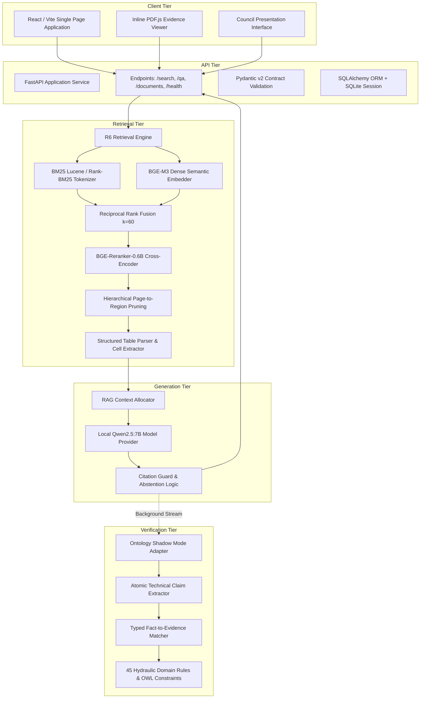

# VietIrr-RAG Architecture Specification

## Overview

VietIrr-RAG is structured as a decoupled research and production-capable system for evidence-grounded question answering over long, structured Vietnamese hydraulic engineering documents. The architecture separates offline layout parsing and multi-vector indexing from online hybrid retrieval, context allocation, local generative modeling, and factual verification.

## Module Architecture

## Component Responsibilities

### 1. API Service Tier (`src/viirr_api/`)
- `app.py`: FastAPI entrypoint managing lifecycle events, CORS origins, and request validation.
- `settings.py`: Immutable environment configuration loading database URIs, rate limits, and context token budgets.
- `models.py` & `schemas.py`: Relational ORM models and Pydantic validation contracts ensuring strict payload typing.
- `r6_service.py`: Service adapter linking HTTP requests to the retrieval engine and generation pipeline.

### 2. Retrieval Tier (`src/viirr_retrieval/`)
- `bm25.py`: Lexical BM25 indexing using domain-specific Vietnamese hydraulic tokenization.
- `dense.py`: Dense semantic retrieval wrapping BGE-M3 embeddings.
- `rrf.py`: Reciprocal Rank Fusion combining lexical and dense candidate lists.
- `reranker.py`: Cross-encoder reranker refining top candidate sets.
- `table_aware.py`: Parses markdown and cell-level matrices for hydraulic registries and monitoring bulletins.
- `evidence_allocator.py`: Context window budget management packing top evidence blocks without exceeding context limits.

### 3. Generation & Grounding Tier (`src/viirr_rag/`)
- `provider.py`: Interface to local Qwen 2.5:7B serving via Ollama or vLLM.
- `pipeline.py`: Context prompt construction enforcing numerical precision.
- Citation Guard: Post-generation hallucination filter verifying that every assertion is bound to a canonical evidence ID (`REG_...` or `TAB_...`).

### 4. Ontology Verification Tier (`src/viirr_ontology/`)
- `domain/`: 45 formalized hydraulic domain constraints (water elevations, dead storage limits, discharge thresholds).
- `schema/`: TechnicalClaim and EvidenceItem models.
- `adapters/`: Non-blocking Shadow Mode adapter running factual verification in parallel for diagnostic telemetry.
