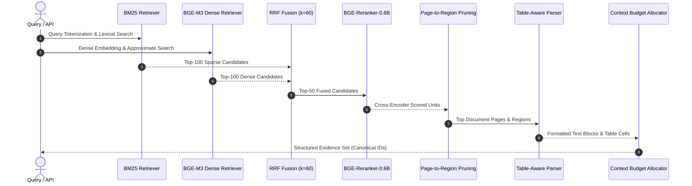

# R6 Hybrid Retrieval Pipeline

## Overview

The R6 retrieval pipeline in VietIrr-RAG addresses the unique challenges of Vietnamese hydraulic engineering documents: long multi-page reports, fine-grained numerical elevation constraints, complex tabular telemetry, and multi-hop questions requiring cross-page synthesis.

## Pipeline Architecture

## Detailed Processing Stages

### 1. Lexical Retrieval (BM25)
- **Tokenization**: Domain-aware normalization preserving Vietnamese compound words (e.g., `mực nước dâng bình thường`, `cao trình đỉnh đập`, `dung tích chết`, `lưu lượng xả tràn`).
- **Scoring**: Standard Okapi BM25 parameterized with $k_1 = 1.5$, $b = 0.75$.
- **Function**: Guarantees high recall on precise numerical terms, reservoir names, and legal decision identifiers (e.g., `Quyết định 1201/QĐ-TTg`).

### 2. Dense Semantic Retrieval (BGE-M3)
- **Encoder**: BGE-M3 producing 1024-dimensional normalized dense vectors.
- **Search Space**: 27,144 layout-aware evidence units (27,053 text regions and 91 table regions).
- **Function**: Captures conceptual relationships, query paraphrasing, and hydrological intent where exact keyword matching fails.

### 3. Reciprocal Rank Fusion (RRF)
Candidates from BM25 and BGE-M3 are merged using standard RRF:

$$RRF(d) = \sum_{m \in \{BM25, BGE-M3\}} \frac{1}{60 + r_m(d)}$$

where $r_m(d)$ represents the rank of document unit $d$ under model $m$.

### 4. Cross-Encoder Re-ranking (BGE-Reranker-0.6B)
The top 50 fused candidates are scored jointly with the query using `BAAI/bge-reranker-large` / `bge-reranker-v2-m3`. The cross-encoder computes deep cross-attention between question tokens and document text, dramatically improving precision over bi-encoder embeddings alone.

### 5. Hierarchical Page-to-Region Localization
Rather than treating documents as flat paragraph lists, R6 models document hierarchy:
1. **Document Candidate Selection**: Identifies the primary source documents.
2. **Page Pruning**: Identifies the highest-density evidence pages within each document.
3. **Region Isolation**: Retains only the specific bounding boxes (`TEXT_REGION` or `TABLE_REGION`) containing the relevant facts.

### 6. Table-Aware Evidence Construction
When an evidence unit is of type `TABLE_REGION`:
- Column headers and row descriptors are reconstructed into a linearized markdown table.
- Individual cells retain coordinate IDs (e.g., `TAB_..._R006_C012`).
- Prevents table truncation and preserves column-to-value bindings during generation.

### 7. Context Budget Allocation
Top-ranked evidence blocks are packed greedily into the context window up to the configured token budget (default: 4,000 tokens), ensuring diverse document coverage without exceeding LLM context capacity.
