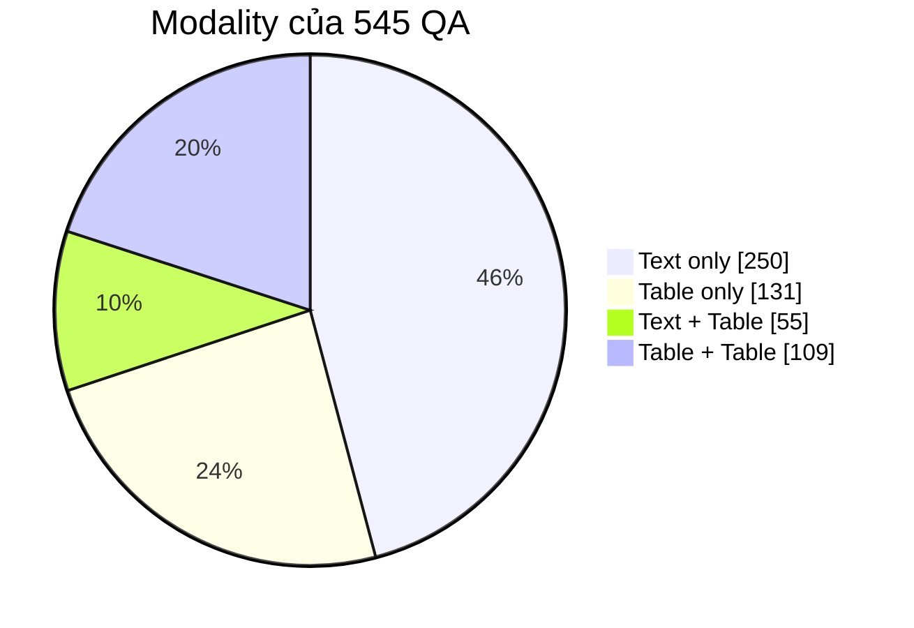
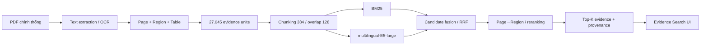
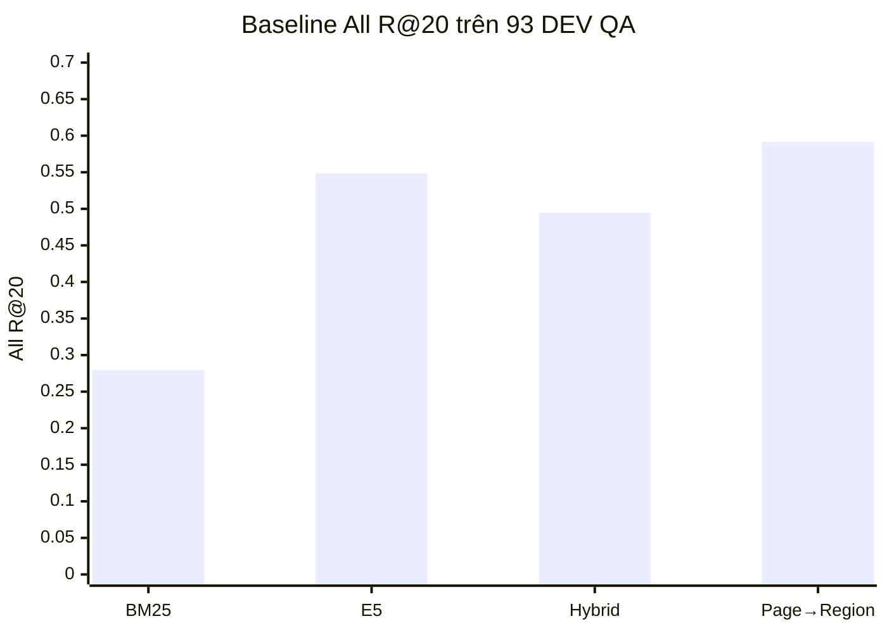
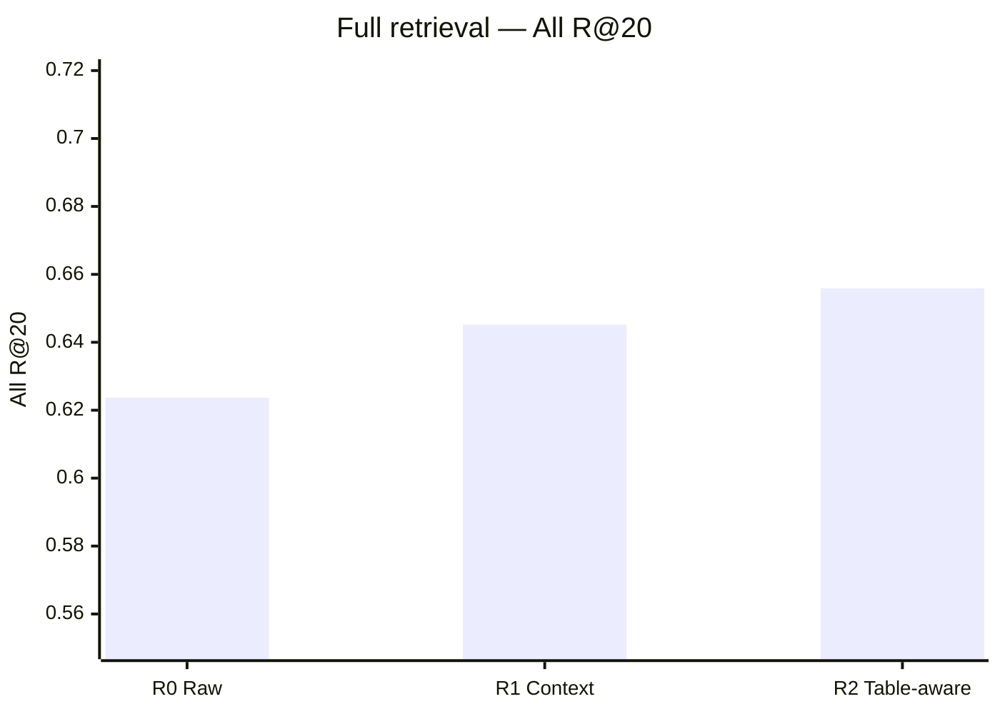
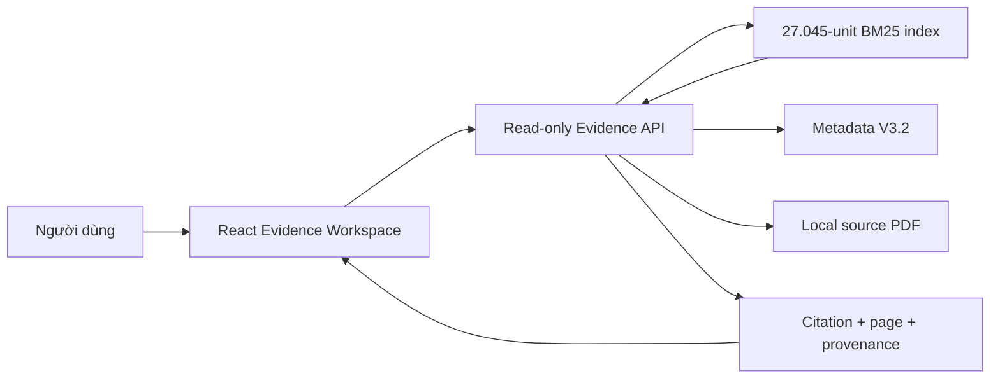

<!-- _class: lead -->
<!-- _paginate: false -->

# VIETIRR-RAG

## Truy xuất bằng chứng từ tài liệu thủy lợi Việt Nam

**Báo cáo giữa kỳ · Evidence-first Retrieval · 13/10/2026**

> Từ PDF dài, bảng biểu và dữ liệu OCR đến bằng chứng có nguồn, số trang và khả năng kiểm chứng.

**Sinh viên:** ........................................  
**Giảng viên:** ........................................

---

# 01 · Bài toán nghiên cứu

Tài liệu thủy lợi có ba đặc điểm khó:

1. **Dài và có cấu trúc:** nhiều trang, mục, bảng và phụ lục.
2. **Đa dạng hình thức:** văn bản số, bảng, PDF scan/OCR.
3. **Câu hỏi cần nhiều bằng chứng:** cùng trang, khác trang hoặc khác tài liệu.

### Câu hỏi nghiên cứu

> Làm thế nào truy xuất **đủ tập bằng chứng** liên quan, giữ đúng provenance và không dùng đáp án/gold trong quá trình inference?

**Phạm vi hiện tại:** retrieval và evidence interface; chưa xây dựng bộ sinh câu trả lời RAG.

---

# 02 · Đóng góp của workspace

<div class="cols">
<div>

### Dữ liệu

- Corpus V3.2 đã semantic freeze.
- QA core/challenge và negative có provenance.
- Split theo document/family, leakage bằng 0.
- Theo dõi text, table, thời gian và quan hệ bằng chứng.

</div>
<div>

### Hệ thống

- Baseline lexical, dense và hybrid.
- Page→Region retrieval.
- Chunking theo evidence unit và sliding window.
- Reranking, set-aware và modality-aware diagnostics.
- Frontend Evidence Search với citation/PDF.

</div>
</div>

---

# 03 · Dataset V3.2 — số liệu chính

<div class="center">
  <span class="metric"><b>89</b>Tài liệu</span>
  <span class="metric"><b>2.479</b>Trang</span>
  <span class="metric"><b>30.382</b>Regions</span>
  <span class="metric"><b>406</b>Bảng</span>
  <span class="metric"><b>545</b>QA accepted</span>
</div>

| Thành phần | Số lượng | Ghi chú |
|---|---:|---|
| Core QA | **378** | Câu hỏi nền tảng |
| Challenge QA | **167** | Multi-evidence/cross-page/cross-document |
| Source-grounded negatives | **704** | 373 minimal + 331 hard non-minimal |
| QA được sửa semantic | **63** | Topic, OCR entity/metric, temporal semantics |
| Critical semantic red flags | **0** | Sau final semantic patch |
| Human validated | **Không** | Phải trình bày rõ khi báo cáo |

Nguồn: `reports/v3_2_final_semantic/dataset_stats.json`.

---

# 04 · Phân bố QA



| Vị trí bằng chứng | QA | Tỷ lệ |
|---|---:|---:|
| Cùng trang | 445 | 81,65% |
| Khác trang, cùng tài liệu | 34 | 6,24% |
| Khác tài liệu | 66 | 12,11% |

**Ý nghĩa:** benchmark không chỉ kiểm tra “tìm một đoạn đúng”, mà còn kiểm tra khả năng thu hồi **đủ tập bằng chứng**.

---

# 05 · Split và chống leakage

| Split | Tổng QA | Core | Challenge | Retrieval-multi | Cross-document |
|---|---:|---:|---:|---:|---:|
| Train | 343 | 289 | 54 | 11 | 0 |
| Dev | **93** | 68 | 25 | **25** | 3 |
| Candidate Test | 109 | 21 | 88 | 88 | 63 |

- Document/family leakage: **0**.
- Candidate Test: **SEALED — không parse, không evaluate** trong các thí nghiệm.
- Dev có 25 multi-evidence QA nhưng chỉ **8 unique multi gold sets**.
- Candidate Test tập trung 100% vào một family → `SERIES_HOLDOUT_HEAVY=true`.

> Đây là lý do mọi kết luận hiện tại chỉ mang tính **exploratory trên Dev**.

---

# 06 · Pipeline tổng thể



**Nguyên tắc:** index chỉ chứa dữ liệu nguồn; không chứa câu hỏi, answer hay gold evidence.

---

# 07 · Evidence unit và chunking

### Evidence universe dùng cho retrieval

- **27.045 units**: 26.954 text regions + 91 table regions đủ điều kiện index.
- Mỗi unit giữ `evidence_id`, `doc_id`, `page_id`, `page_number`, loại và raw text.
- Unit là đơn vị đánh giá; chunk chỉ là đơn vị encoding.

### Sliding-window chunking

| Tham số | Giá trị |
|---|---:|
| Content tokens/window | **384** |
| Overlap | **128 tokens** |
| Encoder max length | **512 tokens** |
| Window aggregation | **Max pooling** về evidence ID gốc |
| Post-window truncation | **0%** |

**Lý do:** tránh cắt mất nội dung dài nhưng vẫn giữ mapping chính xác từ embedding window về region/table nguồn.

---

# 08 · Các representation được kiểm tra

| Representation | Nội dung serialization |
|---|---|
| **R0 — Raw** | Nội dung region/table gốc |
| **R1 — Contextualized** | Document title + page + section/local parent đã xác minh + content |
| **R2 — Table-aware** | R1; riêng 91 bảng dùng serialization có cấu trúc |

- Missing context được **bỏ qua**, không điền `UNKNOWN` vào embedding text.
- Không sửa raw content và không dùng QA/gold/answer.
- Pre-window truncation: R0 **1,04%**, R1 **1,13%**, R2 **1,26%**.
- Sau windowing: cả ba đều **0% truncation**.

> Kết luận R1: contextualization có point gain trong vài setting nhưng **không có cluster-supported full-retrieval gain**.

---

# 09 · Embedding và lexical retrieval

### Dense encoder

- Model: **`intfloat/multilingual-e5-large`**.
- Revision cố định: `3d7cfbdacd47fdda877c5cd8a79fbcc4f2a574f3`.
- Prefix: `query:` và `passage:`.
- `max_length=512`, `batch_size=16`, **L2 normalization**.
- Dense score: cosine/dot product trên vector đã normalize.

### Lexical + fusion

- BM25: `k1=1.5`, `b=0.75`.
- Tokenizer: Unicode NFC + casefold + word tokenization.
- Reciprocal Rank Fusion:

$$RRF(d)=\sum_m\frac{1}{60+rank_m(d)}$$

- Tie-break deterministic: score giảm dần, sau đó `evidence_id`.

---

# 10 · Metric đánh giá

| Metric | Ý nghĩa |
|---|---|
| **Any Recall@K** | Top-K chứa ít nhất một gold evidence |
| **All Recall@K** | Top-K chứa đủ toàn bộ gold evidence của QA |
| **Gold Coverage@K** | Tỷ lệ các gold evidence được thu hồi |
| **Candidate Coverage@B** | Pool B candidates chứa đủ gold set |
| **MRR** | Gold đầu tiên xuất hiện sớm đến đâu |
| **nDCG@10** | Chất lượng thứ hạng đầu danh sách |

Với bài toán multi-evidence, metric chính là:

$$AllRecall@K=\frac{1}{N}\sum_{q=1}^{N}\mathbb{1}[G_q\subseteq R_q^K]$$

**Không đánh đồng candidate coverage với final All R@20.**

---

# 11 · Baseline B2



| Method | Any R@10 | All R@20 | MRR | nDCG@10 |
|---|---:|---:|---:|---:|
| BM25 | 0,2688 | 0,2796 | 0,0950 | 0,1128 |
| E5 | 0,5161 | 0,5484 | 0,2736 | 0,2937 |
| Hybrid RRF | 0,4839 | 0,4946 | 0,2627 | 0,2767 |
| **Page→Region** | **0,6452** | **0,5914** | **0,2997** | **0,3412** |

---

# 12 · B2: điều gì đã học được?

### Page→Region hoạt động tốt, nhưng page localization là nút thắt

- Page→Region All R@20: **0,5914**.
- Table-only All R@20: **0,8718** (n=39).
- Retrieval-multi All R@20: **0,4400**.
- Cross-document All R@20: **0,3333** (n=3, chỉ mô tả).

### Failure tại K=20

```text
PAGE_LOCALIZATION  ████████████████████████████████  32
REGION_RANKING     ██████                             6
CANDIDATE_MAPPING                                      0
```

**Quyết định:** nghiên cứu page representation và candidate recovery trước khi tối ưu reranker phức tạp.

---

# 13 · Page representation & candidate budget

### P0 / P1 / P2

- **P0:** raw page text.
- **P1:** page được chia 6.004 windows, tối đa 384 tokens.
- **P2:** page representation được pool từ 27.045 source units, có table.

| Điều kiện | Complete page recall | All R@20 | Final All R@50 |
|---|---:|---:|---:|
| P0, Top-10 pages | 0,6559 | 0,5914 | 0,6452 |
| P0, Top-20 pages | 0,7849 | 0,6022 | **0,7527** |
| **P2, Top-10 pages** | **0,6989** | **0,6129** | 0,6882 |
| P2, Top-20 pages | 0,7957 | 0,6022 | **0,7527** |

**Phát hiện:** tăng page/candidate coverage không đảm bảo tăng final recall.

---

# 14 · Coverage ≠ Final Recall

Ví dụ P2 với candidate budget B=100:

```text
Strategy        Candidate Coverage@100       Final All R@20
S0 / P=10       ██████████████  0,6989        ████████████  0,6129
S1 / P=20       ████████████████ 0,7849       ████████████  0,6022
S2 / Rescue     ████████████████ 0,7849       ██████████    0,5269
```

- S1 tăng coverage **+0,0860**, nhưng Δ All R@20 = **−0,0108**.
- S2 tăng coverage **+0,0860**, nhưng Δ All R@20 = **−0,0860**.
- Nút thắt chuyển từ page pruning sang **region ranking / rank displacement**.

> Candidate tốt hơn chỉ tạo cơ hội; selector/ranker vẫn phải đưa đủ evidence vào Top-20.

---

# 15 · Zero-shot reranking

Cross-encoder: **`BAAI/bge-reranker-v2-m3`**, max length 512, FP16, batch 16.

| Method @ B100 | Coverage | All R@10 | All R@20 | nDCG@10 | ms/query |
|---|---:|---:|---:|---:|---:|
| M0 pool-local RRF | 0,7742 | 0,4516 | 0,6129 | 0,3244 | 32,54 |
| M1 global-rank RRF | 0,7742 | 0,4624 | 0,6237 | 0,3195 | **24,15** |
| **M2 cross-encoder** | 0,7742 | **0,5484** | **0,6452** | **0,3842** | 752,41 |

- M2 recovered 9 và regressed 6 QA so với M0.
- Δ All R@20 CI 95%: **[−0,0538; +0,1075]** → chưa chứng minh superiority.
- Reranker không thể sửa **21 candidate misses**.

---

# 16 · Complete-evidence set selection

| Experiment | Candidates | Selector | Coverage@100 | All R@20 | Multi All R@20 |
|---|---|---|---:|---:|---:|
| E0 | G0 | Global RRF | 0,7742 | 0,6237 | 0,6000 |
| E1 | G1 | Global RRF | 0,8172 | 0,5054 | 0,5200 |
| E2 | G0 | Cross-encoder | 0,7742 | 0,6452 | 0,4400 |
| E3 | G0 | Set-aware V1 | 0,7742 | 0,6237 | 0,6000 |
| **E4** | G0 | Set-aware V2 | 0,7742 | **0,6559** | **0,6000** |

E4 recovered 3, regressed 0 so với E0; tuy nhiên:

- QA bootstrap CI: **[0,0000; 0,0753]**.
- Gold-set cluster CI: **[0,0000; 0,1012]**.
- Multi-evidence không cải thiện.

**Kết luận:** point estimate tốt, nhưng chưa đủ bằng chứng để claim superiority.

---

# 17 · Contextualized representation R1/R2



| Representation | Coverage@100 | All R@20 | Multi All R@20 | Indexing time |
|---|---:|---:|---:|---:|
| R0 | 0,7742 | 0,6237 | 0,6000 | 160,44 s |
| R1 | 0,7849 | 0,6452 | **0,6400** | 230,23 s |
| R2 | **0,7849** | **0,6559** | **0,6400** | 240,11 s |

Cluster bootstrap vẫn bao gồm 0 → **NO_RELIABLE_CONTEXTUALIZATION_GAIN**.

---

# 18 · MASH-ER: modality-aware + soft hierarchy

| Method | Representation | Localization | Coverage@100 | All R@20 |
|---|---|---|---:|---:|
| A0 | Raw | Hard Page→Region | 0,7742 | **0,6237** |
| A1 | Raw | Soft hierarchy | 0,8172 | 0,5376 |
| A2 | Multi-view | Hard Page→Region | 0,7849 | 0,5054 |
| A3 | Multi-view | Soft hierarchy | **0,8602** | 0,4731 |

### Cơ chế quan sát được

- Soft localization tăng candidate coverage.
- Nhưng candidate mới gây **rank displacement**.
- A3−A0 All R@20 = **−0,1505**; QA bootstrap CI hoàn toàn âm.
- Latency A0→A3: **18,16 → 29,34 ms/query**.

**Decision:** `METHOD_PROMISING=false`, không tiếp tục claim phương pháp mới.

---

# 19 · MAR-ER one-shot

MAR-ER thử ba cơ chế có kiểm soát:

1. Adaptive fusion.
2. Candidate recovery: anchor 80 + rescue 20.
3. Rank stability: bảo vệ Top-15, intrusion budget 5.

| Method | Coverage@100 | All R@20 | Multi All R@20 | Latency |
|---|---:|---:|---:|---:|
| M0 baseline | 0,7742 | **0,6237** | 0,6000 | 17,30 ms |
| M1 adaptive | 0,7742 | **0,6237** | 0,6000 | 24,52 ms |
| M2 recovery | 0,8065 | 0,5269 | 0,5600 | 24,51 ms |
| M3 stability | 0,7742 | **0,6237** | 0,6000 | 17,66 ms |
| M4 full | **0,8280** | 0,5914 | **0,6000** | 24,81 ms |

M4 recovered 2 nhưng regressed 5 final QA → **STOP_MAR_ER_BRANCH**.

---

# 20 · Tổng hợp tiến trình nghiên cứu

```text
Observed point estimates trên cùng DEV (khác điều kiện kiểm soát)

BM25 baseline             0,2796  ██████
E5 baseline               0,5484  ███████████
Page→Region B2            0,5914  ████████████
Matched M0 / Global RRF   0,6237  █████████████
Cross-encoder E2          0,6452  █████████████
Set-aware E4 / R2         0,6559  ██████████████  ← point estimate cao nhất
```

### Kết luận khoa học

- **Không** có phương pháp đề xuất nào được chứng minh vượt baseline một cách đáng tin cậy.
- Candidate coverage tăng nhưng final complete-evidence recall có thể giảm.
- Bottleneck thực tế: **candidate miss + rank displacement**.
- Negative result được giữ nguyên, không tuning lại sau khi xem kết quả.

---

# 21 · Hệ thống demo Phase E



- Landing premium + 3D hydrology orb, WebGL/reduced-motion fallback.
- Workspace search, history cục bộ, evidence panel và citation.
- Document explorer: metadata, filter, indexable regions và PDF.
- Chỉ số landing lấy từ API/corpus thật.
- Không có LLM serving → hiển thị rõ **Evidence Search**, không bịa answer.

---

# 22 · Kiểm thử và khả năng tái lập

| Hạng mục | Kết quả |
|---|---|
| Dataset leakage | **0** document/family leakage |
| Candidate Test | Sealed, byte-hash only |
| Full Python test suite | **109 passed** |
| Phase E API integration | **4 passed** |
| TypeScript/build | **PASS** |
| HTTP search → citation | **PASS** |
| PDF byte-range | **PASS** |
| WebGL fallback | Có |

Frontend được route-split; Three.js là lazy chunk riêng. Research data, rankings và reports không bị sửa bởi Phase E.

---

# 23 · Demo trực tiếp

Khởi động:

```powershell
.\start_phase_e.cmd
```

Mở: `http://127.0.0.1:5173`

### Ba truy vấn nên demo

1. `Quy trình vận hành liên hồ chứa trên lưu vực sông Hồng`
2. `Chất lượng nước hệ thống Nam Măng Thít năm 2024`
3. `Dự báo chất lượng nước Cái Lớn - Cái Bé tháng 4 năm 2025`

**Luồng trình diễn:** nhập query → đọc Top evidence → bấm citation → kiểm tra cơ quan/trang → mở PDF đúng trang.

---

# 24 · Hạn chế

1. `HUMAN_VALIDATED=false`; chưa thể gọi đây là human gold benchmark.
2. Dev chỉ có 93 QA; multi-evidence chỉ có 8 unique gold sets.
3. Dev đã được dùng nhiều lần để diagnosis → rủi ro overfitting nghiên cứu.
4. Candidate Test chưa được đánh giá và có concentration theo series.
5. Metadata thời gian/provenance chưa có verified reference labels đầy đủ.
6. OCR và table extraction vẫn có sai số nguồn.
7. Interface hiện chỉ phục vụ retrieval, chưa có answer generation.
8. Chưa có external benchmark hoặc đánh giá người dùng.

> Không được trình bày `PAPER_READY=true` hay claim SOTA.

---

# 25 · Hướng phát triển có kiểm soát

### Ưu tiên 1 — chất lượng đánh giá

- Human review mẫu và agreement giữa annotators.
- Đánh giá Candidate Test đúng một lần sau khi protocol được khóa.
- Thêm external/independent benchmark.

### Ưu tiên 2 — retrieval

- Candidate generator tập trung recall nhưng có bảo vệ rank.
- Học hoặc calibrate selector trên train, không tuning tiếp trên Dev.
- Đánh giá theo unique gold set và document family.

### Ưu tiên 3 — RAG

- Chỉ thêm answer generation sau khi retrieval đủ ổn định.
- Bắt buộc citation, abstention và kiểm chứng theo nguồn/trang.

---

# 26 · Câu hỏi phản biện dự kiến

**Vì sao dùng multilingual-E5-large?**  
Phù hợp tiếng Việt và có baseline dense mạnh; revision được pin để tái lập.

**Vì sao chunk 384, overlap 128?**  
Cho phép encode unit dài trong giới hạn 512; overlap giữ ngữ cảnh biên, max pool trả về evidence ID gốc.

**Tại sao coverage tăng mà recall giảm?**  
Candidate mới cạnh tranh score và đẩy gold evidence khỏi Top-20.

**Tại sao không chạy Candidate Test?**  
Giữ test độc lập; toàn bộ design/diagnosis hiện chỉ trên Dev.

**Tại sao UI không trả lời tự nhiên?**  
Workspace chưa có LLM serving; evidence-only tránh tạo claim không có nguồn.

---

# 27 · Kết luận

1. Đã xây dựng corpus và benchmark có provenance cho tài liệu thủy lợi dài, có bảng và multi-evidence.
2. Dense retrieval vượt BM25; Page→Region cải thiện baseline ban đầu.
3. Chunking 384/128 loại bỏ truncation sau windowing và giữ mapping về evidence gốc.
4. Best observed point estimate là **All R@20 = 0,6559**, nhưng chưa có superiority được xác nhận thống kê.
5. Nút thắt hiện tại là **candidate miss và rank displacement**, không chỉ là embedding.
6. Phase E cung cấp giao diện kiểm chứng evidence/PDF hoàn chỉnh và trung thực.

> **Thông điệp chính:** hệ thống đã tái lập được, đo đúng failure và biết rõ giới hạn — đây là nền tảng cần thiết trước khi xây RAG sinh câu trả lời.

---

<!-- _class: lead -->

# Cảm ơn thầy và các bạn

## Q & A

**Demo:** `http://127.0.0.1:5173`  
**Artifacts:** `reports/`, `outputs/`, `frontend/`, `docs/`

---

# Phụ lục A · Artifact đối chiếu

| Nội dung | Artifact nguồn |
|---|---|
| Dataset V3.2 | `reports/v3_2_final_semantic/dataset_stats.json` |
| Baseline B2 | `reports/B2/B2_BASELINE_REPORT.md` |
| Page representation | `reports/B2_1/B2_1_REPORT.md` |
| Candidate coverage | `reports/B2_2/B2_2_REPORT.md` |
| Reranking | `reports/B2_3/B2_3_REPORT.md` |
| Evidence selection | `reports/C1/C1_REPORT.md`, `reports/C1_1/C1_1_REPORT.md` |
| Representation | `reports/R1/R1_REPORT.md` |
| MASH-ER | `reports/MASH_ER/MASH_ER_REPORT.md` |
| MAR-ER | `reports/MAR_ER_EXPERIMENT/MAR_ER_REPORT.md` |
| Phase E | `docs/PHASE_E_FRONTEND.md` |

---

# Phụ lục B · Quy ước báo cáo

- Dùng dấu phẩy cho số thập phân trong slide; artifact JSON/CSV dùng dấu chấm.
- Mọi metric retrieval trong phần chính dùng **DEV n=93**.
- `All R@20` là complete-evidence recall, không phải token/answer recall.
- Kết quả subgroup có N nhỏ chỉ mang tính mô tả.
- Các bảng E0/E2/E4, R0/R1/R2 và M0–M4 có điều kiện kiểm soát khác nhau; không coi toàn bộ là một leaderboard tuyệt đối.
- Không suy luận causal nếu audit chỉ chứng minh association.
- Không dùng từ “tốt nhất/SOTA” nếu CI còn chứa hoặc chạm 0.
